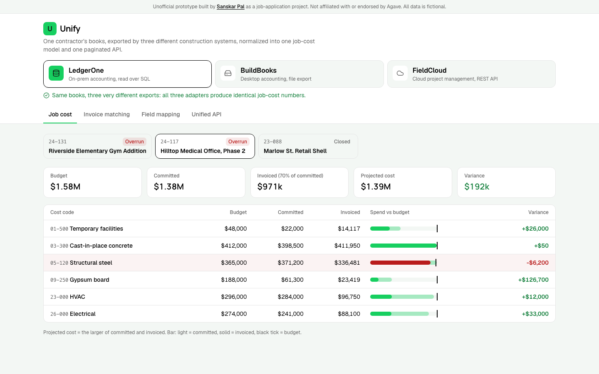

# Unify

One contractor's books, exported by three very different construction systems, normalized into one job-cost model and one paginated API. An unofficial prototype for Agave, built by Sanskar Pal while applying for the Software Engineer role.

**Live demo:** [agave-unify.vercel.app](https://agave-unify.vercel.app) · **Stack:** React 19, TypeScript, Tailwind v4, Vitest, Vercel Functions



## Why

Agave's [engineering posting](https://jobs.ashbyhq.com/agave/986e328a-7d38-4092-a3ac-e54dcafe1287) names the core challenge: unifying dozens of fragmented construction systems, many of them 20–40 years old, under one standard for data models, filters and pagination. [Agave's site](https://useagave.com) lists ERP sync, AP automation and job costing (cost codes, commitments, budget matching) across Sage, Viewpoint, QuickBooks, Procore and more. This prototype is a small, honest slice of that problem.

## What it does

- **Three source systems, one answer.** LedgerOne (on-prem SQL rows), BuildBooks (desktop file export) and FieldCloud (cloud REST JSON) are fictional, but each has the kinds of quirks real ones do: upper-case columns, budgets split by cost category, `$1,234.56` strings, `Customer:Job` names, PO numbers that lose their prefix, float dollars, budgets as original + approved changes. Switch between them and the job-cost numbers stay identical; the banner checks that live.
- **Job cost.** Budget, committed, invoiced, projected (the larger of committed and invoiced) and variance per cost code, with overruns highlighted.
- **Invoice-to-commitment matching.** Each bill is tied to its subcontract or PO using the strongest evidence the source offers: an explicit link, then a PO/SC number typed into the memo, then a unique vendor + cost code match. Ambiguity is reported, not guessed. Bills that push a commitment past 100% are flagged for a change order.
- **Field mapping.** Pick an invoice and see the native record next to the unified one.
- **Unified API.** `GET /api/v1/{projects|cost-codes|commitments|invoices}` with filters, stable ordering and an opaque cursor that remembers its filters. The in-page explorer runs the exact handler the deployed Vercel function uses.

## How it works

- [src/lib/types.ts](src/lib/types.ts): the unified model. Integer cents, ISO dates, `source:nativeId` ids.
- [src/lib/adapters/](src/lib/adapters): one pure function per system, `native export → UnifiedDataset`. Anything readable but unmappable becomes a warning instead of being dropped.
- [src/lib/matching.ts](src/lib/matching.ts): evidence-ranked matching and over-billing detection (walks bills in date order and flags the one that crosses the line).
- [src/lib/jobcost.ts](src/lib/jobcost.ts): roll-up per cost code, plus a source-independent fingerprint used by the consistency check.
- [src/lib/api.ts](src/lib/api.ts): the request handler; [api/v1/[resource].ts](api/v1/[resource].ts) is a thin Vercel wrapper around it.
- [src/data/](src/data): the canonical books, and simulated exports that re-express them in each system's shape.

23 tests (`npm test`): every adapter maps every record with no warnings, all three produce identical job-cost fingerprints, each matching path, ambiguity, over-billing, the money/date parsers, cursor paging, filter validation and the function wrapper.

## Tradeoffs and what I'd do next

- The source systems and data are fictional and much smaller than real ones; real adapters need incremental sync, rate limits and retries, and auth per customer.
- Data is computed in memory per request; in production the unified model lives in Postgres with a sync cursor per source, and hot reads go through a Redis cache.
- Matching is rules-based and explainable. Next I'd add amount-based heuristics (retainage, partial pay apps) and a review queue for ambiguous matches whose decisions train the rules.
- Next: change-order handling (budget revisions as events), retainage, and writing approved bills back to the source ERP.

## Run locally

```bash
npm install
npm run dev
npm test
```

---

Not affiliated with or endorsed by Agave. LedgerOne, BuildBooks and FieldCloud are made-up systems, and all data is fictional.
